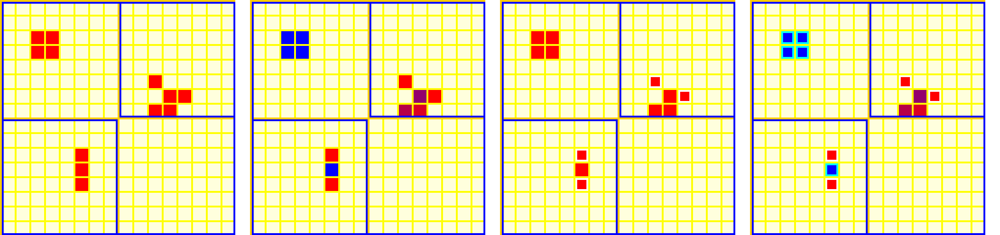

# 001. 세포 시각화 효과를 Decorator로 조합

- 문제: 세포는 생사 두 가지 색으로만 그려져서 언제 태어났고 얼마나 살아남았는지 화면에서 알 수 없다. 나이 표시, 신생 강조, 장수 강조를 추가하되 사용자가 원하는 것만 골라 동시에 켤 수 있어야 한다. 그리기 코드는 `Resident.redraw()` 안에 색 상수와 함께 박혀 있었다.
- 대안:
  - A. `Resident.redraw()`에 옵션 `boolean`과 `if` 추가 — 가장 단순하다. 그러나 효과가 늘 때마다 `Resident`를 고쳐야 하고, 세포 상태와 표현이 한 클래스에 섞인다.
  - B. Strategy로 렌더러 교체 — E1의 규칙 교체와 같은 구조라 익숙하다. 그러나 한 번에 하나만 고를 수 있어서, 효과 3개를 조합하려면 조합마다 클래스가 필요하다(8개).
  - C. Decorator로 렌더러를 감싸기 — 효과 하나가 클래스 하나이고 조합은 감싸는 것으로 끝난다. 대신 클래스 수가 늘고, 데코레이터끼리 서로의 결과를 덮어쓰지 않도록 규칙이 필요하다.
- 결정: C. 효과가 서로 독립이고 조합이 요구사항이므로 Decorator가 맞다. `Cell` 자체를 감싸지 않고 `CellRenderer`를 새로 뽑아 감쌌다. `Cell`은 메서드가 13개이고 `Neighborhood`가 `Resident` 타입에 의존하고 있어 감싸기에 적합하지 않기 때문이다. 덮어쓰기 문제는 `RendererDecorator.draw()`를 `final`로 두어 "안쪽이 먼저 그리고, 데코레이터는 그 위에 덧그리기만 한다"는 순서를 강제해 풀었다(Template Method).
- 결과:
  - 추가: `CellRenderer`, `BasicRenderer`, `RendererDecorator`, `AgeDecorator`, `NewbornDecorator`, `SurvivorDecorator`
  - 수정: `Resident`(나이 추적, 그리기 위임), `Neighborhood`(`changeRenderer` 전파), `Universe`(View 메뉴, 효과 사용 중 전체 다시 그리기)
  - 테스트: `BasicRendererTest`, `ResidentAgeTest`, `RendererDecoratorTest`, `NeighborhoodRendererTest`, `UniverseViewMenuGuiTest`
  - 화면: 같은 보드를 Normal / Show Cell Age / Highlight Newborn / 세 효과 동시 적용으로 그린 결과

    

## 함께 내린 결정과 한계

- 나이는 모델에 둔다. 렌더러가 그릴 정보가 필요하므로 `Resident`에 `age`를 추가했다. 따라서 "게임 로직을 전혀 수정하지 않았다"고는 할 수 없고, 수정 범위는 `Resident` 한 클래스의 상태 하나다. 생존 규칙 계산(`LifeRule`)은 건드리지 않았다.
- 나이 1은 "방금 나타남"이다. 규칙으로 태어난 세포, 사용자가 클릭한 세포, 불러온 세포 모두 1에서 시작한다.
- Undo/Redo는 그 세대의 나이를 그대로 되돌린다. 나이 색의 목적이 "얼마나 오래 살아남았는지"이므로, 이전 세대로 돌아가면 색도 그 세대의 색이어야 한다. 기존 `Memento`는 살아 있는 좌표만 담으므로 `BoardSnapshot`이 칸별 나이를 별도 배열로 함께 보관하고, Memento로 생사를 복원한 뒤 나이를 덮어쓴다. 나이 순회는 `changeRule`/`changeRenderer`와 같은 방식으로 `Neighborhood`가 하위 칸에 재귀로 전달한다. `Memento`와 `.life` 파일 형식은 바꾸지 않았다.
- Load는 나이를 1로 시작한다. `.life` 파일에는 이력이 없으므로 불러온 세포는 "방금 나타남"으로 본다.
- 효과가 켜져 있으면 매 세대 보드 전체를 다시 그린다. 원본은 변화가 없는 블록의 다시 그리기를 건너뛰는데, 나이는 생사가 그대로여도 변하므로 이 최적화를 그대로 쓰면 색이 갱신되지 않는다. Normal에서는 원본과 같이 동작한다.
- 보드 전체가 안정되면 나이도 멈춘다. `AdvanceGenerationCommand`가 변화가 없는 세대의 `transition()`을 생략하기 때문이다. 화면에 움직임이 없는 상태이므로 그대로 두었다.
