# Holub Life Game 원본 분석

Allen Holub의 *Holub on Patterns* 3장에 나오는 Game of Life 구현(v1.02)을 코드 기준으로 정리한 문서.
과제의 "기존 설계와 비교" 부분에서 **비교 기준(Before)** 으로 쓴다.

- 소스 위치: [`src/main/java/com/holub/`](../src/main/java/com/holub/)
- 출처, 링크 정리: [`reference/resources.md`](reference/resources.md)

> 아래 내용은 모두 코드를 직접 읽고 확인했다. 줄 번호는 커밋 `ef7d962` 기준.

---

## 목차

1. [Conway's Game of Life](#1-conways-game-of-life)
2. [프로그램 사용법](#2-프로그램-사용법)
3. [전체 구조](#3-전체-구조)
4. [핵심 동작](#4-핵심-동작)
5. [적용된 설계패턴](#5-적용된-설계패턴)
6. [한계와 개선 포인트](#6-한계와-개선-포인트)
7. [UI 없이 모델 테스트하기](#7-ui-없이-모델-테스트하기)

---

## 1. Conway's Game of Life

1970년 John Conway가 만든 세포 자동자(cellular automaton). 2차원 격자의 각 칸(셀)은 **살아 있음 / 죽어 있음** 두 상태만 갖고, 매 세대마다 주변 8칸(이웃)을 보고 다음 상태를 정한다.

| 현재 상태 | 살아 있는 이웃 수 | 다음 상태 |
|---|---|---|
| 살아 있음 | 2 또는 3 | 생존 |
| 살아 있음 | 0~1 (고립) 또는 4 이상 (과밀) | 죽음 |
| 죽어 있음 | 정확히 3 | 탄생 |
| 죽어 있음 | 그 외 | 그대로 죽음 |

B/S 표기로는 **B3/S23** (Born 3 / Survive 2, 3).

모든 셀은 **동시에** 바뀐다. 즉 다음 세대는 오직 현재 세대만 보고 계산해야 한다. 셀을 하나씩 바로 바꾸면 이미 바뀐 이웃을 참조하게 되어 결과가 틀어진다. 원본이 계산을 2단계로 나누는 이유가 이것이다 ([4.2](#42-한-세대-계산-2단계-갱신)).

Holub은 이 예제를 고른 이유로 **창발(emergence)** 을 든다. 글라이더가 대각선으로 움직이는 동작은 어디에도 프로그래밍되어 있지 않고, 셀 하나의 단순한 규칙에서 저절로 생긴다. 작은 객체가 자기 일만 하고 전체 동작은 협력에서 나온다는 것이 OO 설계의 핵심이라는 관점이다.

---

## 2. 프로그램 사용법

```bash
javac -encoding UTF-8 -d out $(find src/main/java -name '*.java')
java -cp out com.holub.life.Life
```

### 화면

- 64 × 64 격자, 셀 하나는 8px → 창 크기 512 × 512
- 빨간 칸 = 살아 있는 셀, 연노랑 칸 = 죽은 셀
- 주황 테두리 = 8 × 8 블록(`Neighborhood`) 경계
- **파란 테두리 = 이번 세대에 변화가 있는 블록.** 계산 최적화([4.3](#43-최적화-변화-없는-블록-건너뛰기))가 화면에 그대로 보인다.
- 격자 바깥은 항상 죽은 셀로 취급한다 (고정 벽, 토러스 아님).

### 조작

| 조작 | 동작 | 구현 위치 |
|---|---|---|
| 셀 클릭 | 생/사 토글 | `Universe` 마우스 리스너 → `Cell.userClicked` |
| Grid → Clear | 모든 셀 죽이기 | `Universe.java:106` |
| Grid → Load | `.life` 파일 불러오기 (시계 정지 후 보드 비우고 로드) | `Universe.doLoad()` |
| Grid → Store | `.life` 파일로 저장 (시계 정지) | `Universe.doStore()` |
| Grid → Exit | 종료 | `Universe.java:134` |
| Go → Halt | 정지 | `Clock.java:101` |
| Go → Tick (Single Step) | 한 세대만 진행 | `Clock.tick()` |
| Go → Agonizing / Slow / Medium / Fast | 500 / 150 / 70 / 30 ms 간격으로 자동 진행 | `Clock.java:98-101` |

---

## 3. 전체 구조

### 패키지

| 패키지 | 클래스 | 역할 |
|---|---|---|
| `com.holub.life` | `Life` | 진입점. `JFrame`을 만들고 `Universe`를 붙임 |
| | `Universe` | Swing과 모델 사이의 중재자. 보드 생성, 메뉴, 클릭, 저장/로드, 화면 갱신 |
| | `Cell` | 셀 공통 인터페이스. `DUMMY`, `Memento`, `STORE`/`LOAD` 상수 포함 |
| | `Neighborhood` | 셀 묶음(복합 셀). 실제 계산과 최적화 담당 |
| | `Resident` | 셀 하나(단말). 생존 규칙이 여기 있음 |
| | `Clock` | 타이머. tick마다 구독자에게 알림. 속도 메뉴 생성 |
| | `Direction` | 블록의 어느 가장자리가 변했는지 나타내는 비트마스크 |
| | `Storable` | 저장 가능한 객체 (`load`, `flush`) |
| `com.holub.ui` | `MenuSite` | 메뉴바 관리 (정적 메서드만 있는 Facade) |
| | `Colors` | 색상 상수 |
| `com.holub.tools` | `Publisher` | 스레드 안전한 구독자 목록. Observer 구현용 |
| | `Log` | 로깅 설정 유틸리티 (Life에서는 안 씀) |
| `com.holub.io` | `Files` | 파일 선택 다이얼로그 |
| `com.holub.asynch` | `ConditionVariable` | 조건이 참이 될 때까지 대기하는 동기화 도구 |

### 패키지 의존 관계

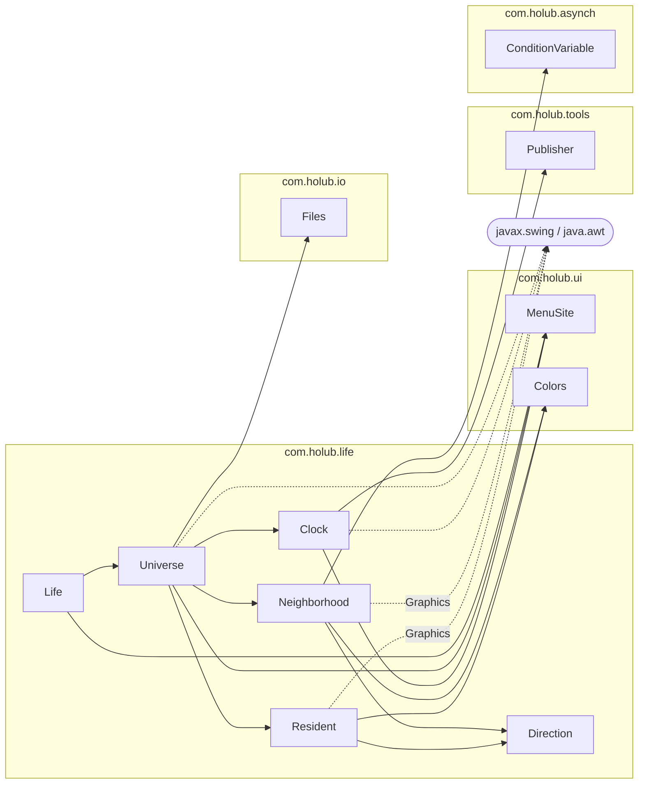

> 모델 클래스(`Neighborhood`, `Resident`)도 `java.awt.Graphics`와 `com.holub.ui.Colors`에 의존한다. 모델과 UI가 분리되어 있지 않다는 뜻 ([6절](#6-한계와-개선-포인트) #4).

### 클래스 다이어그램

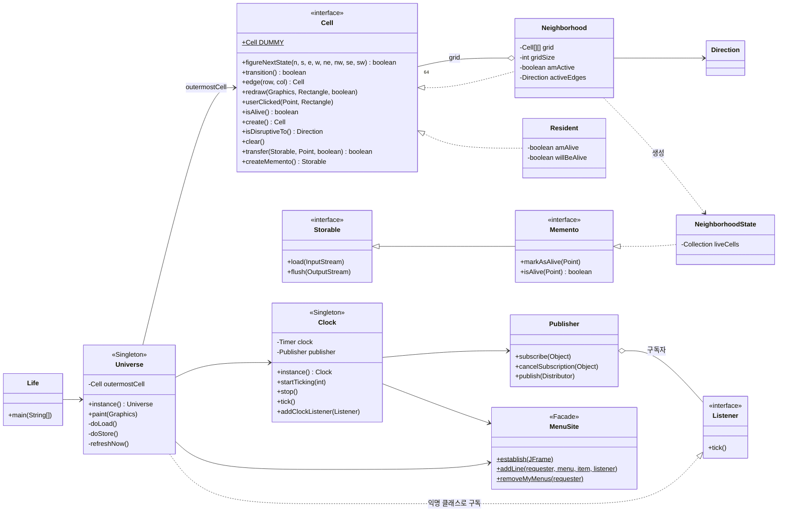

### 보드 구성

`Universe` 생성자([`Universe.java:56-62`](../src/main/java/com/holub/life/Universe.java#L56-L62))가 Composite 트리를 만든다.

```java
outermostCell = new Neighborhood( 8,            // 8×8 블록 ...
                    new Neighborhood( 8,        //   각 블록은 8×8 셀 ...
                        new Resident() ) );     //     각 셀은 Resident
```

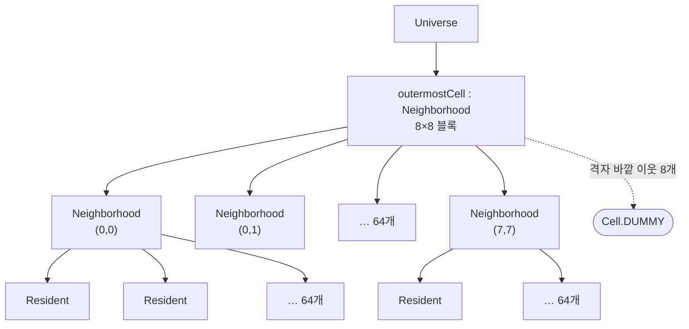

```text
화면 (512 × 512 px)
┌────────┬────────┬─ … ─┬────────┐
│ 블록   │ 블록   │     │ 블록   │   블록 = Neighborhood (8×8 셀, 64 × 64 px)
│ (0,0)  │ (0,1)  │     │ (0,7)  │   셀   = Resident (8 × 8 px)
├────────┼────────┼─ … ─┼────────┤
│   …    │        │     │        │   8 × 8 블록 × 8 × 8 셀 = 64 × 64 = 4096 셀
├────────┼────────┼─ … ─┼────────┤
│ (7,0)  │        │     │ (7,7)  │
└────────┴────────┴─ … ─┴────────┘
```

`Neighborhood` 생성자는 두 번째 인자로 받은 셀을 **원형(prototype)** 으로 보고 `prototype.create()`를 `gridSize²`번 호출해 칸을 채운다 ([`Neighborhood.java:65-73`](../src/main/java/com/holub/life/Neighborhood.java#L65-L73)). 원형 자체는 격자에 들어가지 않는다.

---

## 4. 핵심 동작

### 4.1 생존 규칙

규칙은 `Resident.figureNextState()` 한 줄에 박혀 있다 ([`Resident.java:61`](../src/main/java/com/holub/life/Resident.java#L61)).

```java
willBeAlive = (neighbors==3 || (amAlive && neighbors==2));
```

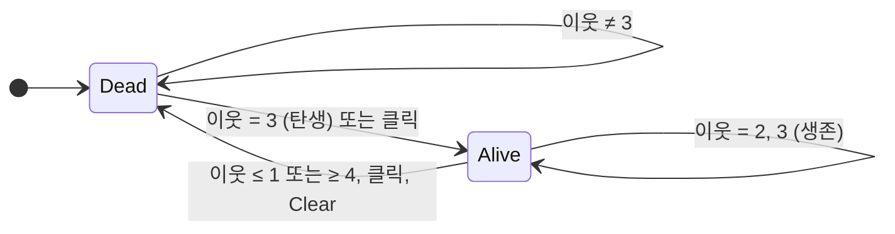

`Resident`는 이 상태를 필드 두 개로 나눠 들고 있다.

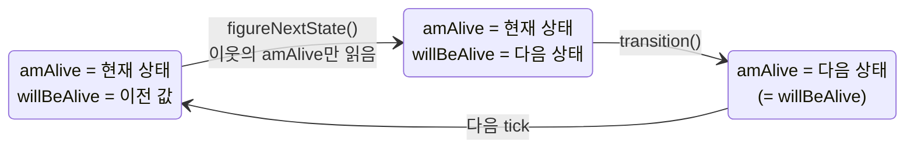

### 4.2 한 세대 계산: 2단계 갱신

모든 셀이 동시에 바뀌어야 하므로([1절](#1-conways-game-of-life)) 계산을 둘로 나눈다.

| 단계 | 메서드 | 하는 일 |
|---|---|---|
| ① 계산 | `figureNextState(8개 이웃)` | 현재 상태(`amAlive`)만 보고 다음 상태를 `willBeAlive`에 **적어만 둔다** |
| ② 반영 | `transition()` | `amAlive = willBeAlive`로 한꺼번에 바꾼다 |

두 메서드 모두 `Cell` 인터페이스에 있어서, 바깥 블록에 한 번 호출하면 Composite 트리를 따라 모든 셀로 재귀 전달된다.

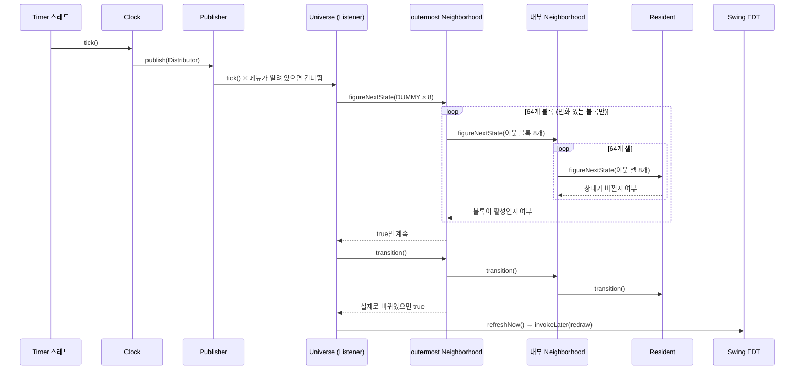

**이웃 찾기.** 셀은 자기 이웃을 필드로 갖지 않는다. 블록이 계산할 때마다 이웃을 인자로 넘겨준다. 블록 가장자리 셀의 이웃은 옆 블록에 있으므로 `north.edge(gridSize-1, column)`처럼 옆 블록에 가장자리 셀을 물어본다 ([`Neighborhood.java:156-218`](../src/main/java/com/holub/life/Neighborhood.java#L156-L218)).

```text
Example: neighbors of cell grid[0][0] (★) in block B  (gridSize = 8)

+---------------------+---------------------+---------------------+
| NW                  | N                   | NE                  |
| northwest.edge(7,7) | north.edge(7,0)     | north.edge(7,1)     |
|  (other block)      |  (other block)      |  (other block)      |
+---------------------+---------------------+---------------------+
| W                   | ★                   | E                   |
| west.edge(0,7)      | grid[0][0]          | grid[0][1]          |
|  (other block)      |                     |                     |
+---------------------+---------------------+---------------------+
| SW                  | S                   | SE                  |
| west.edge(1,7)      | grid[1][0]          | grid[1][1]          |
|  (other block)      |                     |                     |
+---------------------+---------------------+---------------------+
```

블록 안쪽 셀은 이웃 8개가 모두 자기 `grid`에 있다. 가장자리 셀만 옆 블록의 `edge()`를 부른다.

**격자 바깥.** 가장 바깥 블록은 이웃 8개를 모두 `Cell.DUMMY`로 받는다 ([`Universe.java:145-148`](../src/main/java/com/holub/life/Universe.java#L145-L148)). `DUMMY`는 항상 죽어 있고 `edge()`를 물으면 자기 자신을 돌려주므로, 격자 바깥은 무한히 이어지는 죽은 셀처럼 동작한다. 덕분에 경계 처리용 `if`가 필요 없다.

### 4.3 최적화: 변화 없는 블록 건너뛰기

대부분의 블록은 대부분의 시간 동안 아무 일도 없다. 그래서 블록마다 두 가지 정보를 기억한다.

| 필드 | 의미 |
|---|---|
| `amActive` | 지난 세대에 이 블록 안에서 변화가 있었는가 |
| `activeEdges` (`Direction`) | 변화가 **어느 가장자리**에서 있었는가 (북·남·동·서·네 모서리 비트) |

블록은 **자기가 활성이거나, 이웃 블록이 나와 맞닿은 쪽 가장자리에서 변했을 때만** 계산한다 ([`Neighborhood.java:133-142`](../src/main/java/com/holub/life/Neighborhood.java#L133-L142)).

```java
if(    amActive
    || north    .isDisruptiveTo().the( Direction.SOUTH     )
    || south    .isDisruptiveTo().the( Direction.NORTH     )
    ...
    || southwest.isDisruptiveTo().the( Direction.NORTHEAST ) )
{   // 블록 안 셀 전부 계산
}
```

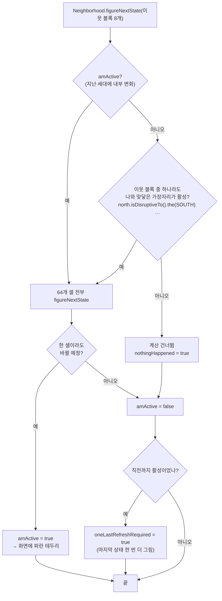

`transition()`에서 상태가 바뀐 셀이 블록 가장자리에 있으면 해당 방향 비트를 켠다 ([`Neighborhood.java:299-325`](../src/main/java/com/holub/life/Neighborhood.java#L299-L325)).

```text
8×8 블록에서 각 칸이 켜는 Direction 비트

 NW+N+W  N  N  N  N  N  N  NE+N+E
   W     ·  ·  ·  ·  ·  ·    E
   W     ·  ·  ·  ·  ·  ·    E
   W     ·  ·  ·  ·  ·  ·    E        · = 내부 칸, 비트 없음
   W     ·  ·  ·  ·  ·  ·    E
   W     ·  ·  ·  ·  ·  ·    E
   W     ·  ·  ·  ·  ·  ·    E
 SW+S+W  S  S  S  S  S  S  SE+S+E
```

`Direction`은 비트마스크 클래스다. `NORTH`, `ALL`, `NONE` 같은 공용 상수는 내부 `Immutable` 하위 클래스로 만들어서, 실수로 `add()`나 `clear()`를 부르면 예외가 난다 ([`Direction.java:69-83`](../src/main/java/com/holub/life/Direction.java#L69-L83)).

> **v1.01 버그 수정.** 원래는 `activeEdges.clear()`를 `figureNextState()`에서 불렀는데, 그러면 이웃 블록이 아직 그 값을 읽기 전에 지워져서 블록 경계를 넘던 글라이더가 멈추거나 사라졌다. `transition()`으로 옮겨서 해결했다 ([`Neighborhood.java:149`](../src/main/java/com/holub/life/Neighborhood.java#L149), [`:270`](../src/main/java/com/holub/life/Neighborhood.java#L270)).

### 4.4 시간: Clock

- `java.util.Timer`로 일정 간격마다 `tick()`을 호출한다. **Timer 스레드에서 돈다** (Swing EDT 아님).
- `tick()`은 `Publisher`를 통해 등록된 `Clock.Listener` 전부에게 알린다. 현재 구독자는 `Universe` 하나.
- 속도 메뉴는 메뉴 항목 이름의 **첫 글자**로 분기한다 (`'T'` → 한 세대, `'A'` → 500ms, `'S'` → 150ms, `'M'` → 70ms, `'F'` → 30ms, 그 외 → 정지) ([`Clock.java:92-101`](../src/main/java/com/holub/life/Clock.java#L92-L101)).
- **v1.02 땜질.** 실행 중 메뉴를 열면 게임 그림이 메뉴를 덮어쓰는 Swing 문제가 있었다. Swing은 "메뉴가 열렸다"는 이벤트를 주지 않으므로, tick마다 `MenuSelectionManager`를 직접 확인해서 메뉴가 열려 있으면 알림을 건너뛴다 ([`Clock.java:172-176`](../src/main/java/com/holub/life/Clock.java#L172-L176)). Holub은 주석에서 이것을 **Facade(`MenuSite`)를 우회하는 사례**라고 직접 설명한다.

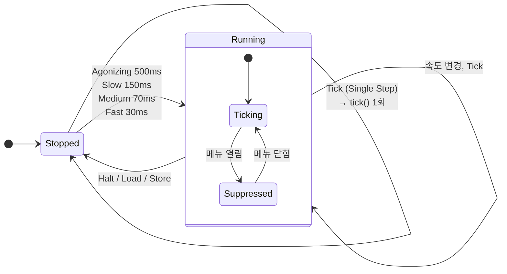

> 이 상태는 코드에 명시적으로 없다. `tick`(`TimerTask`) 필드가 `null`인지 아닌지로만 구분된다 ([6절](#6-한계와-개선-포인트) #7).

`Publisher`는 구독자를 **불변 연결 리스트**로 관리한다. 알림 중에 구독 목록이 바뀌어도 알림 시작 시점의 목록에 있던 구독자만 받는다. 새 구독자를 리스트 앞에 붙이므로 **나중에 구독한 쪽이 먼저 알림을 받는다**. 알림 방법은 `Distributor` 객체로 넘기는데, Holub 주석은 이것을 Visitor의 `visit`에 해당한다고 설명한다 ([`Publisher.java`](../src/main/java/com/holub/tools/Publisher.java)).

### 4.5 화면 그리기

| 경로 | 언제 | 무엇을 |
|---|---|---|
| `Universe.paint()` | Swing이 다시 그리기를 요청할 때 (창 노출, 클릭 후 `repaint()`) | `redraw(g, bounds, drawAll=true)` — 전부 |
| `Universe.refreshNow()` | tick 후 변화가 있을 때 | `SwingUtilities.invokeLater`로 EDT에 넘겨서 `redraw(..., drawAll=false)` — 변한 블록만 |

- 셀이 **자기 자신을 그린다** (`Cell.redraw(Graphics, ...)`). 셀 크기는 셀이 들고 있지 않고 그릴 때 `Rectangle`로 전달받는다.
- Timer 스레드가 `transition()` 중일 때 EDT가 그리면 반쯤 바뀐 상태가 보일 수 있다. 그래서 `Neighborhood`의 정적 `ConditionVariable readingPermitted`를 가장 바깥 `transition()`이 `false`로 바꾸고, `redraw()`는 이것이 `true`일 때만 그린다 ([`Neighborhood.java:43`](../src/main/java/com/holub/life/Neighborhood.java#L43), [`:267-281`](../src/main/java/com/holub/life/Neighborhood.java#L267-L281), [`:360-363`](../src/main/java/com/holub/life/Neighborhood.java#L360-L363)).
- 이번 세대에 막 안정된 블록도 마지막 상태를 한 번 더 그려야 하므로 `oneLastRefreshRequired` 플래그를 둔다.

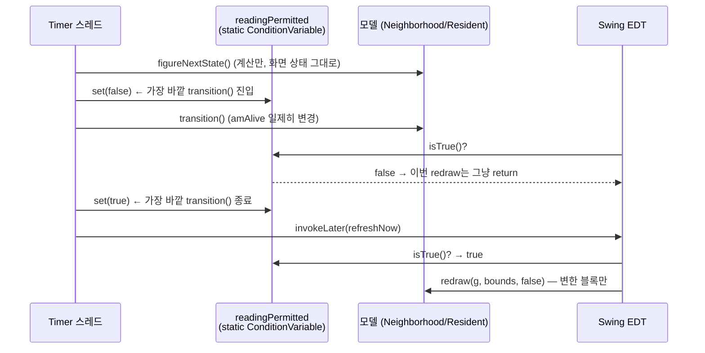

> `nestingLevel`(정적 필드, 초기값 -1)로 "가장 바깥 호출인지"를 판단한다. 재귀로 들어갈 때마다 1 증가, 나올 때 1 감소.

### 4.6 클릭

`Universe`가 클릭 좌표를 가장 바깥 블록에 넘기면, 각 블록은 좌표를 칸 크기로 나눠 해당 하위 셀을 찾고 **하위 셀 기준 상대 좌표**로 바꿔 다시 넘긴다. `Resident`에 도달하면 `amAlive`를 뒤집는다. 지나가는 블록은 모두 활성으로 표시되고, 가장자리 칸이면 `activeEdges`도 갱신된다 ([`Neighborhood.java:405-420`](../src/main/java/com/holub/life/Neighborhood.java#L405-L420)).

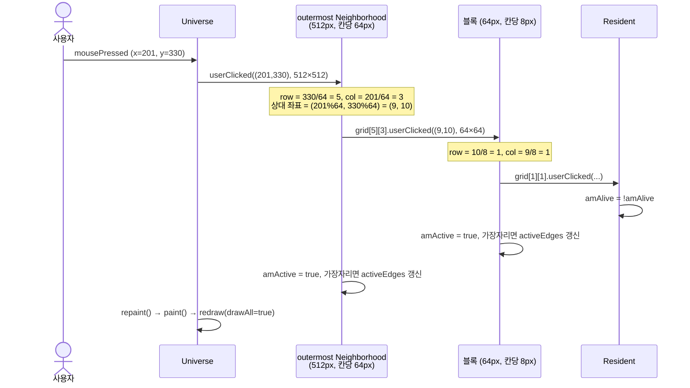

→ 이 셀은 전체 격자 기준 (행 41, 열 25).

### 4.7 저장 / 불러오기

Memento 패턴. 보드 내부 구조를 밖에 드러내지 않고 상태만 꺼내고 넣는다.

| 단계 | Store | Load |
|---|---|---|
| 1 | `Clock` 정지 | `Clock` 정지, 보드 비움 |
| 2 | `createMemento()` → 빈 `NeighborhoodState` | `createMemento()` → 빈 `NeighborhoodState` |
| 3 | `transfer(memento, (0,0), STORE)` — 살아 있는 셀이 자기 **절대 좌표**를 `markAsAlive`로 기록 | `memento.load(in)` — 파일에서 좌표 목록 읽기 |
| 4 | `memento.flush(out)` — 파일에 쓰기 | `transfer(memento, (0,0), LOAD)` — 각 셀이 `isAlive(좌표)`를 물어 자기 상태 설정 |

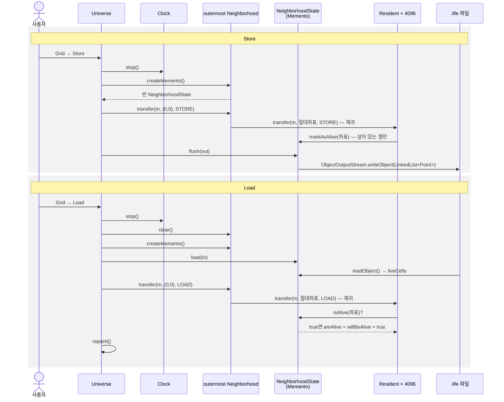

- 각 블록은 `transfer()`를 하위 셀로 넘기면서 좌상단 좌표를 하위 셀 너비만큼 옮겨 준다. 그래서 `Resident`는 자기 절대 좌표를 몰라도 된다.
- 파일 형식은 **살아 있는 셀 좌표(`java.awt.Point`)의 `LinkedList`를 Java 직렬화한 것**이다 ([`Neighborhood.java:481-526`](../src/main/java/com/holub/life/Neighborhood.java#L481-L526)). 확장자는 `.life`. 사람이 읽을 수 없고 다른 Life 프로그램과 호환되지 않는다. 주석에 "나중에 XML로 바꿀 수도 있다"고 적혀 있다.

---

## 5. 적용된 설계패턴

"근거"는 Holub이 코드 주석에 직접 패턴 이름을 적은 경우 ✍️, 구조로 판단한 경우 🔍로 표시했다.

| 패턴 | 어디에 | 왜 / 어떻게 | 근거 |
|---|---|---|---|
| **Composite** | `Cell` ← `Neighborhood`(복합) / `Resident`(단말) | 셀 하나와 셀 묶음을 같은 인터페이스로 다룬다. `figureNextState`, `transition`, `redraw`, `userClicked`, `transfer`가 트리를 따라 재귀 전달된다 | ✍️ `Universe` 주석 |
| **Prototype** | `Neighborhood(int, Cell prototype)`, `Cell.create()` | 생성자가 구체 클래스를 몰라도 원형의 `create()`로 칸을 채운다. 중첩 구조를 생성자 두 번으로 조립할 수 있는 이유 | ✍️ `Neighborhood` 주석 ("clone" method) |
| **Flyweight** | `figureNextState`의 이웃 인자, `redraw`의 `Rectangle` | 이웃과 화면 위치를 셀이 저장하지 않고 호출 때마다 받는다 (외재적 상태). 셀은 `amAlive`, `willBeAlive`만 가진다 | ✍️ `Neighborhood.java:106-107` |
| **Null Object** | `Cell.DUMMY` | 격자 바깥을 "항상 죽은 셀"로 대신해 경계 검사를 없앤다. 주석은 Singleton이라고도 부른다 | 🔍 (✍️ "DUMMY Singleton") |
| **Singleton** | `Universe.instance()` (즉시 생성), `Clock.instance()` (지연 생성 + `synchronized`) | `Clock`은 생성자에서 메뉴를 만들어야 해서 `MenuSite.establish()` 이후에 생성되도록 지연 생성을 쓴다 | ✍️ 두 클래스 주석 |
| **Observer** | `Clock` → `Clock.Listener` (via `Publisher`) | 시계는 누가 tick을 쓰는지 모른다. `Universe`가 구독한다 | ✍️ `Clock` 주석 ("observers") |
| **Visitor (변형)** | `Publisher.Distributor.deliverTo()` | 구독자에게 무엇을 어떻게 전달할지를 객체로 넘긴다. 클래스 주석은 Strategy라고도 설명한다 | ✍️ `Publisher.java` |
| **Memento** | `Cell.Memento`, `Neighborhood.NeighborhoodState` | 내부 구조를 숨긴 채 상태를 저장/복원한다 | ✍️ 인터페이스 이름 |
| **Mediator** | `Universe` | Swing 이벤트(클릭, 메뉴, 리사이즈)를 모델 요청으로 바꾼다. 모델과 Swing이 서로를 직접 모른다 | ✍️ `Universe` 주석 |
| **Facade** | `MenuSite` | `JMenuBar`/`JMenu`/`JMenuItem` 조작을 `addLine(requester, "Go", "Fast", listener)` 한 줄로 감춘다. 요청자별로 메뉴를 묶어 `removeMyMenus()`로 한 번에 지울 수 있다 | ✍️ `Clock.java:163-169` |
| **Active Object** (GoF 외) | `Universe.refreshNow()` | 그리기 요청을 Swing 이벤트 큐에 넣어 EDT가 실행하게 한다 | ✍️ `Universe.java:228` |
| **Immutable** | `Direction.Immutable`, `Publisher.Node` | 공유 상수, 스레드 간 공유 리스트를 바뀌지 않게 만든다 | ✍️ 주석 |

---

## 6. 한계와 개선 포인트

과제의 "설계 개선" 후보. 각 항목은 코드 위치로 확인했다.

| # | 문제 | 위치 | 영향 | 개선 방향 (후보) |
|---|---|---|---|---|
| 1 | **생존 규칙이 하드코딩** | `Resident.java:61` | HighLife(B36/S23) 등 다른 규칙을 쓰려면 `Resident`를 고쳐야 함 (OCP 위반) | Strategy |
| 2 | **보드 크기가 상수** | `Universe.java:39, 45` | 크기를 못 바꿈. 주석에 "화면보다 크면 실패하는 버그"가 있다고 적혀 있음 | 설정 주입, Builder/Factory |
| 3 | **경계가 고정 벽뿐** | `Universe.java:145-148` (`DUMMY`) | 토러스(감싸는 경계) 불가 | Strategy (경계 정책) |
| 4 | **모델이 화면을 그림** | `Cell.redraw(Graphics, ...)`, `Resident`의 색상 상수 | 모델이 AWT에 묶임. 색이나 그리는 방식을 바꾸려면 모델을 고쳐야 함 | MVC 분리, 렌더러 Strategy/Visitor |
| 5 | **Singleton과 정적 상태** | `Universe.instance()`, `Clock.instance()`, `Neighborhood`의 정적 `readingPermitted`, `nestingLevel` | 테스트끼리 상태 공유. `Clock`은 생성자에서 메뉴를 만들어서 UI 없이 못 씀 | 의존성 주입, 인스턴스 필드화 |
| 6 | **속도 분기가 메뉴 이름 첫 글자** | `Clock.java:92-101` | 메뉴 이름을 바꾸면 동작이 깨짐. 속도 추가하려면 `if` 사슬 수정 | Command, 속도 값 객체 |
| 7 | **실행 상태가 암묵적** | `Clock.tick` (`TimerTask` 유무로만 구분) | 실행/정지/한 단계 상태와 전이가 코드에 드러나지 않음 | State |
| 8 | **저장 형식이 Java 직렬화** | `Neighborhood.java:481-526` | 사람이 못 읽고 RLE 등 표준 패턴 파일 사용 불가 | Strategy/Adapter (포맷별 Reader/Writer) |
| 9 | **Undo 없음** | — | 잘못 클릭하거나 진행하면 되돌릴 수 없음 | Command + Memento (기존 Memento 재활용 가능) |
| 10 | **스레드 경계 불명확** | 클릭은 EDT, `figureNextState`/`transition`은 Timer 스레드 | 실행 중 클릭하면 계산 중인 셀 상태를 동시에 바꿀 수 있음 | 모델 접근을 한 스레드로 모으기 |
| 11 | **`Neighborhood.isAlive()`가 항상 `true`** | `Neighborhood.java:422-424` | 인터페이스 의미("이 셀이나 하위 셀이 살아 있으면 true")와 다름. 지금은 아무도 안 불러서 문제가 드러나지 않음 | 구현 수정 또는 인터페이스 분리 (ISP) |
| 12 | **오래된 주석** | `Universe.java:47-48, 158-160` | `Neighborhood.createUniverse()`에서 만든다고 적혀 있지만 그런 메서드 없음 | 정리 |
| 13 | **raw type** | `NeighborhoodState.liveCells` 등 | Java 1.4 코드라 제네릭 없음. 최신 JDK에서 경고 | 제네릭 적용 |
| 14 | **`Resident.transition()` 반환값이 반대** | `Resident.java:80-84` | 아래 참고 | 반환값 수정 + 회귀 테스트 |

### #14 상세: `Resident.transition()` 반환값

`Cell` 인터페이스는 `transition()`이 "상태가 바뀌었으면 `true`"를 반환한다고 정의한다 ([`Cell.java:36-40`](../src/main/java/com/holub/life/Cell.java#L36-L40)). 그런데 `Resident`는 **바뀌기 전에 안정 상태였는지(`isStable()`)** 를 반환한다.

```java
public boolean transition()
{   boolean changed = isStable();   // 이름은 changed지만 값은 "안 바뀜"
    amAlive = willBeAlive;
    return changed;
}
```

확인 결과:

| 확인 | 결과 |
|---|---|
| 죽은 셀이 그대로 죽어 있을 때 `transition()` | **`true`** 반환 (인터페이스 정의대로라면 `false`) |
| 글라이더 8가지 시작 위치(블록 모서리를 대각선으로 지나감), 80세대 | 간단한 기준 구현과 **매 세대 일치** |
| R-pentomino, 200세대 | 기준 구현과 **매 세대 일치** |

→ 시뮬레이션 결과는 맞다. 추정 원인: `Neighborhood`는 이 반환값으로 `activeEdges`를 켜는데, 반대로 반환되면 **안 바뀐 가장자리 셀이 비트를 켠다**. 한 줄에 안 바뀐 셀이 거의 항상 있으므로 비트가 실제보다 많이 켜지고, 이웃 블록은 필요 이상으로 계산할 뿐 빠뜨리지는 않는다. 즉 정확성은 유지되고 [4.3](#43-최적화-변화-없는-블록-건너뛰기)의 최적화 효과만 줄어드는 것으로 보인다. 고칠 때는 위 확인을 JUnit 회귀 테스트로 먼저 만들어 두고 고쳐야 한다.

---

## 7. UI 없이 모델 테스트하기

`Universe`와 `Clock`은 Swing·메뉴에 묶여 있지만, `Neighborhood`, `Resident`, `Cell.DUMMY`는 UI 없이 바로 쓸 수 있다. 아래 코드로 `-Djava.awt.headless=true`에서 Blinker(주기 2)가 정상 동작하는 것을 확인했다. 같은 방법으로 글라이더, R-pentomino도 기준 구현과 비교했다 ([#14](#14-상세-residenttransition-반환값)).

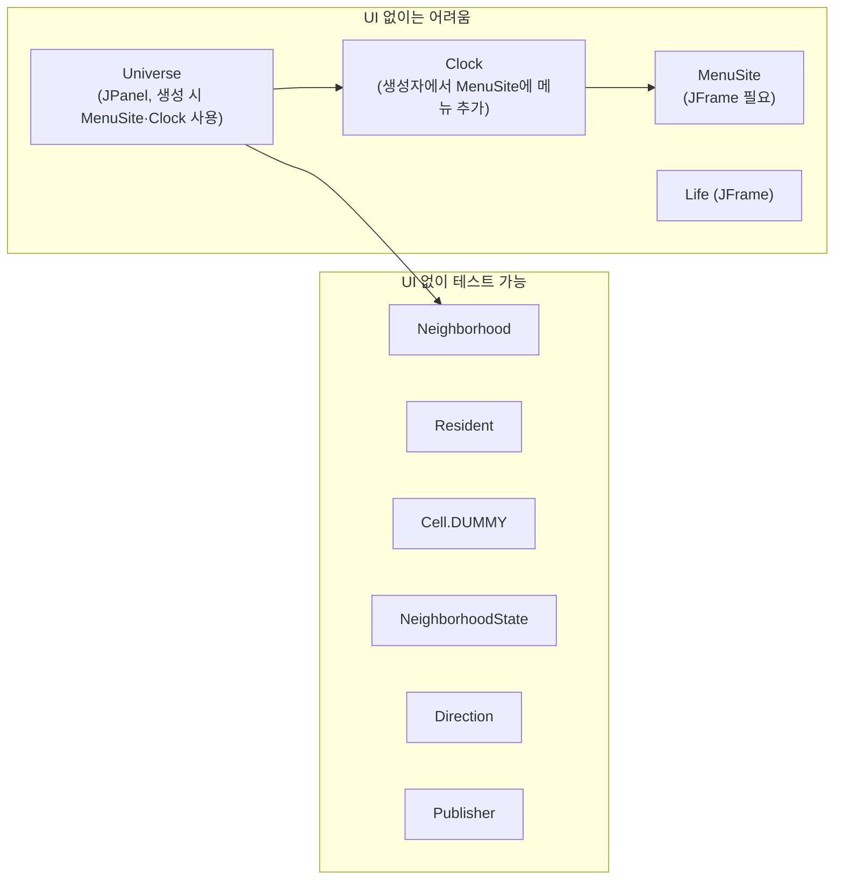

```java
Cell D = Cell.DUMMY;
Cell board = new Neighborhood(8, new Neighborhood(8, new Resident()));   // 64×64
Rectangle surface = new Rectangle(0, 0, 512, 512);                       // 셀당 8px

// (3,4) (4,4) (5,4)에 가로 Blinker 배치
for (int x = 3; x <= 5; x++)
    board.userClicked(new Point(x * 8 + 1, 4 * 8 + 1), surface);

// 한 세대 진행
board.figureNextState(D, D, D, D, D, D, D, D);
board.transition();

// 상태 읽기: Memento로 살아 있는 좌표 확인
Cell.Memento m = (Cell.Memento) board.createMemento();
m.isAlive(new Point(4, 3));   // true — 세로로 바뀜
```

```text
0세대       1세대       2세대
........    ........    ........
........    ........    ........
........    ........    ........
........    ....#...    ........
...###..    ....#...    ...###..
........    ....#...    ........
```

**주의할 점**

- 셀 하나를 직접 지정하는 API가 없어서 **픽셀 좌표 클릭**으로 배치해야 한다.
- 상태를 읽는 API도 없어서 **Memento를 만들어 좌표를 물어봐야** 한다.
- `readingPermitted`, `nestingLevel`이 정적 필드라서 여러 보드를 동시에 다루면 서로 영향을 줄 수 있다.

→ 테스트를 쉽게 만드는 것 자체가 설계 개선 근거가 된다 ([6절](#6-한계와-개선-포인트) #4, #5).
